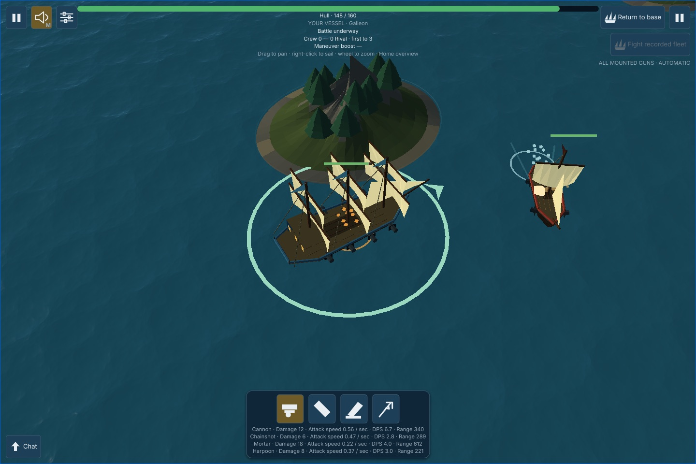

# Keel UI kit

**Declarative Rust UI for your own game engine or native GPU app.**

Bring your renderer, your app model and your event loop. The kit provides composable UI functions, keyed local state,
layout, text, input routing and GPU drawing. Build game HUDs and menus, simulation viewers, editors and native app
interfaces without a DOM or an embedded WebView. Your app owns the window and the frame; the wgpu backend records the
UI into your command encoder, as one more pass after your scene.

Components are plain functions that return a value tree. Local state follows data identity, not call order, and every
interaction is an explicit value. Layout is [taffy] (flexbox and grid) and text is [cosmic-text], both used through
their own types. The same code runs natively (Metal, Vulkan, DX12) and in the browser (wasm + WebGPU).



*Every pixel of UI above is the kit, recorded into the game's own encoder after the 3D scene. The health bars and the
range ring follow the ships in world space. Captured by the game's headless-Chrome WebGPU test.*

## Who owns what

| Your app owns | The kit provides |
|---|---|
| The window and the event loop | Components and their structure |
| App data and the commands that change it | Keyed local UI state, with lifetimes your data decides |
| Assets, decoding, background work | Layout (taffy) and text (cosmic-text) |
| Device, queue, frame pacing and `queue.submit` | UI drawing recorded into your encoder |
| Converting platform events (`kit_winit` does it for winit) | Hit-testing, focus, scrolling, text editing |
| Deciding when to draw | What changed: the UI's own animations, timers and gestures |

A few terms, since they are easy to conflate:

- **Native app** here means a program running directly on the OS, with controls the kit draws on the GPU.
- **No DOM-drawn UI**: in the browser the kit draws into a WebGPU `<canvas>`. The browser host still borrows platform
  pieces: input events, and a hidden textarea for IME and the clipboard.
- **Native OS widgets** (system menus, file dialogs, the platform's accessibility tree) are something else, and the
  kit does not provide them.

## Why own your engine

A focused engine can choose its simulation, renderer, data structures and frame scheduling around the one product it
is for, which matters when the features or performance targets do not fit a general engine's assumptions. Coding
agents make focused engines and custom app shells practical for more projects. The kit is one building block for that
approach: it does the UI and leaves the rest of the architecture to you.

## Examples

### A local app

A simulation viewer's controls. There is no server: `Ask` is just "a command for the app", and the app decides.

```rust
/// What the UI may ask the app to do: set a parameter, save a file, start a job, send a message.
#[derive(Clone, Debug, PartialEq)]
enum Command {
    Speed(f64),
    ToggleRecording,
    SaveSnapshot,
}

impl Host for Viewer {
    type Ask = Command;
    fn ask(&mut self, command: Command) {
        match command {
            // The app decides: while recording, speed is capped at 2x.
            Command::Speed(speed) if self.recording && speed > 2.0 => {}
            Command::Speed(speed) => self.speed = speed,
            Command::ToggleRecording => self.recording = !self.recording,
            Command::SaveSnapshot => self.saved.push(self.speed),
        }
    }
    // now() and motion(): the clock and the reduced-motion preference, both inputs.
}

fn controls(cx: &Cx<'_, Viewer>, theme: &Theme) -> Node<Intent<Viewer>> {
    let (app, ui) = (cx.app(), Ui::new(theme));
    let record = match app.recording {
        true => "Stop recording",
        false => "Record",
    };
    column([
        slider(Slider {
            theme,
            key: "speed",
            label: "Speed",
            value: app.speed, // always the app's value: a refused change snaps back
            range: 0.5..=4.0,
            step: Step::By(0.5),
            on_change: |speed| Intent::Ask(Command::Speed(speed)),
        }),
        ui.labeled_button(DISK, record).on_press(Intent::Ask(Command::ToggleRecording)).into(),
        ui.labeled_button(DISK, "Save snapshot").on_press(Intent::Ask(Command::SaveSnapshot)).into(),
    ])
}
```

The controls hold no copy of the speed, so nothing can drift from the app. The program is a test
([`kit_widgets/tests/components/local_app.rs`](kit_widgets/tests/components/local_app.rs)): it drives the slider with
real keys and checks that a refused change leaves the slider on the app's value.

### A keyed list with server data

A shop list where each row has its own pin (local state) and a Buy button (a request to the server):

```rust
/// A row's identity is the item's id, and it lives exactly as long as the server lists the item.
#[derive(Clone, PartialEq, Eq, Hash, Debug)]
struct Row(u32);
impl Ident<Shop> for Row {
    fn life(&self, shop: &Shop) -> Life {
        match shop.items.iter().any(|item| item.id == self.0) {
            true => Life::Live,
            false => Life::Over,
        }
    }
}

/// A component is a plain function: app data and props in, a value tree out. It re-runs every frame.
fn shop(cx: &Cx<'_, Shop>, theme: &Theme) -> Node<Intent<Shop>> {
    let ui = Ui::new(theme);
    column(cx.app().items.iter().map(|item| {
        let key = Row(item.id);
        // Local state inside a loop, keyed by data (not call order). The reducer cannot capture anything.
        let pinned = cx.state(
            &key,
            || false,
            |pinned: &mut bool, key: &Row, event: RowEvent, _: &Shop| match event {
                RowEvent::Pin => {
                    *pinned = !*pinned;
                    Act::none()
                }
                RowEvent::Buy => Act::ask(Buy(key.0)),
            },
        );
        row([
            switch(cx, Switch { theme, key: key.clone(), label: item.name, on: *pinned,
                                press: Press::Sends(pinned.send(RowEvent::Pin)) }),
            ui.labeled_button(COIN, format!("Buy {}", item.name))
                .on_press(pinned.send(RowEvent::Buy)) // a press is a value: testable, replayable
                .into(),
        ])
    }))
}
```

Insert an item at the top and every pin stays with its own item. When the server drops an item, its row's state is
collected. `Shop` is your app model, with the server's data in it. That whole program, including the `Shop` model,
is a test: [`kit_widgets/tests/components/readme.rs`](kit_widgets/tests/components/readme.rs). It drives the
list with real clicks, and checks were confirmed to fail when state is keyed by position or never collected.

## Why use it

- **Your frame, your encoder.** The UI is the last thing you record into the game's own `wgpu::CommandEncoder`
  (`LoadOp::Load`, over your scene). There is no UI-owned window, renderer, whole-UI
  compositing layer or second hit-tester (only translucent groups use an offscreen pass, inside your frame).
- **World-anchored UI built in.** `world(anchor, node)` places UI at a projected 3D point: nameplates, health bars,
  markers.
- **Functional reactive, no dependency lists.** Views are functions from app data to a value tree, re-run every frame.
  Fine for HUDs and menus; long lists cost real time today (see limits for the numbers).
- **Local state without hook rules.** `cx.state(&key, init, reducer)` is keyed by data, so it works in loops, branches
  and reordered lists. The key's `life` (a function of your app data) decides when state is collected. An event that
  arrives for a dead key is refused and counted, never applied to the wrong row.
- **Server data is just your model.** Views read the latest server state directly. A press becomes an `Ask` your host
  sends over the network. Nothing caches a copy that can go stale.
- **Events are data.** Every press, key and edit is an `Intent` value. Tests drive real layouts with real clicks, and
  the clock is an input, so the same events and times give the same intents. (Replay is deterministic in memory; the
  kit has no serialized replay format.)
- **The standard libraries, unwrapped.** A node's style *is* a `taffy::Style`, and text *is* `cosmic-text`. There's
  no layout or text abstraction of the kit's own to learn.
- **No web runtime on native.** Native builds are pure Rust down to wgpu, and CI fails if `wasm-bindgen`, `js-sys` or
  `web-sys` enters any kit crate's native dependency tree. In the browser the kit draws through WebGPU into a
  `<canvas>`: no DOM element draws any UI. The browser host only borrows what it must: the canvas, input events, and a
  hidden textarea for IME and the clipboard.
- **Small, copyable components.** About 25 components (button, checkbox, switch, slider, text field, combo box,
  listbox, menu, modal, tabs, table, toast, tooltip, colour picker…), most 50–190 lines. The library is the
  infrastructure; components are meant to be copied into your crate and restyled.

**Pick it** for a Rust game, simulation viewer, editor or native GPU app with your own wgpu loop, whose UI (HUD, menus,
panels, inspectors, chat, shops) you want to write as declarative components with local state, including multiplayer
apps where the server owns the truth. Images cover item icons, portraits and live render targets.

**Wait** if your UI is controller-first (no spatial navigation yet), shows long lists (no virtualisation yet), or must
work with a screen reader (see limits).

**Pick something else** for a Bevy game (Bevy UI). Choose egui when its large widget set, its integrations and its
maturity matter most; choose the kit when you prefer a component tree with data-keyed state and value events.

## Status and limits

- **One user so far:** it is the entire UI of a multiplayer browser/native game (sign-in, lobby, rooms, in-match HUD,
  four station consoles, shop, chat, settings). That game's DOM UI was deleted in its favour on 2026-10-23.
- **Not on crates.io yet:** depend on it by git or path. Licence: [WTFPL](LICENSE); ported egui code and the
  bundled Inter font keep their own licences ([THIRD_PARTY.md](THIRD_PARTY.md)).
- **No screen-reader support.** The kit builds a semantics tree (roles, labels, values, states) for tests and keyboard
  activation, but nothing hands it to the platform's accessibility API. For a game HUD that may be acceptable; for an
  editor or app that people depend on, it is a serious gap. A native bridge (AccessKit) could consume the same tree;
  it is not built.
- **No gamepad input or spatial navigation.** Focus moves by Tab order (Up/Down walk it too); a controller-driven
  inventory grid needs the game to map buttons to keys and steer focus itself.
- **Long lists are slow; no virtualisation.** Every row is laid out every frame. On an Apple M4
  ([`docs/BENCH.md`](docs/BENCH.md), one run, a list of rows with text and a button), layout takes 2.4 ms per frame at
  100 rows, 28 ms at 1,000 and 326 ms at 10,000; egui's whole CPU frame is about 10× cheaper. The game's 58-node
  in-match HUD lays out in about 23 µs (layout only, text layouts cached). Why a list row costs so much more per node
  than the HUD is not yet profiled.
- **Context menus are the host's.** Right-click and long-press are not recognised by the router: the host detects
  the gesture and opens a menu, and focus is not yet restored when a popup closes.
- **A native starter, no browser starter.** `kit_winit` (winit events, IME, arboard clipboard) and its `starter`
  example run natively. The browser adapter (canvas events, the hidden IME/clipboard textarea) still lives in the game
  that uses the kit; a standalone browser example is planned.
- **Per-frame costs to know about.** The tree is rebuilt every frame, vertex buffers are created per render, and each
  translucent group with two or more items is a full-target offscreen pass. Measure your largest screen.
- **Fewer widgets than egui,** and no built-in docking, plotting or rich-text editing.
- **Server-authority helpers are designed, not built.** That means tracking a sent command to its confirmed, refused
  or unknown outcome (`cx.track` / `cx.read`). Today you model pending requests in your own app data.
- **Requirements:** wgpu 30, Rust 1.97 (edition 2024). WebGPU only on the web; there is no WebGL2 path.

## Drawing into your frame

The kit never owns a window, a surface or a submit. You hand it your encoder and a texture view; it adds one render
pass that draws over the pixels already there (`LoadOp::Load`):

```rust
// once: one renderer per colour format you draw to
let mut kit_gpu = WgpuUi::new(device.clone(), queue.clone(), surface_format);

// every frame
let mut encoder = device.create_command_encoder(&Default::default());
draw_my_scene(&mut encoder, &frame_view);              // your passes: 3D, sprites, post-processing, anything

let mut ui = kit_gpu.begin_frame(&mut text, viewport); // logical size + device scale, shared by layout and drawing
let laid = layout.layout(root, ui.viewport(), ui.text(), &camera)?;
let draws = paint(&laid, &memory, &theme, now);        // a plain-data DrawList
ui.record(&draws, FrameTarget {
    encoder: &mut encoder,                             // YOUR encoder: same command buffer as the scene
    view: &frame_view,                                 // any texture view of `surface_format`
    format: surface_format,
    size: (width, height),                             // physical pixels
})?;

ui.submitted(queue.submit([encoder.finish()]));       // frame over: frees the glyph-atlas pages it used
surface_texture.present();
```

`submitted` takes the `wgpu::SubmissionIndex` of the submit that carried the encoder. Call it even when `record`
returned an error. A `UiFrame` dropped without it is *abandoned*: its CPU text cache still ends the frame, but the atlas
pages it touched stay reserved until a later submitted frame covers them (safe, never freed early), and
the `WgpuUi::abandoned_frames` counter shows a host that forgets.

What that leaves up to you:

- **When in the frame.** Record the UI after your scene, before or after your post-processing (so it is or is not
  tonemapped and bloomed), or before a final blit.
- **Onto what.** Any texture view in the renderer's format: the swapchain, or an offscreen texture you later put on a
  3D screen, use as a minimap, composite, or read back in a test. The game's native GPU test records the HUD into an
  offscreen texture and reads the pixels back.
- **How many.** Several UIs per frame, each its own `begin_frame`. The game draws two canvases this way: the sea with its
  HUD, and the station console.
- **Which GPU API.** Whatever wgpu backend your app enables: Metal, Vulkan, DX12, or WebGPU in the browser. `kit_wgpu`
  itself only asks wgpu for WGSL.
- **Whether it is wgpu at all.** The `DrawList` is plain data (fills, strokes, rounded rects, glyph runs, clip layers).
  `kit_raster` draws the same list on the CPU with tiny-skia for golden tests; another backend only has to consume it.

## The rest of the loop: state and input

The same loop `kit_widgets/tests/components/support.rs` and the game's hosts run:

```rust
// once
let mut store = Store::<App>::new();          // every component's local state, keyed by data
let mut memory = UiMemory::new(viewport);     // hover, focus, scroll, gestures
let (mut layout, router) = (TaffyLayout::new(), Router::default());

// every frame
store.collect(&app);                          // server data changed: end the state of keys whose life is Over
wake_due(&mut app, &mut store);               // timers that reducers scheduled
let cx = Cx::routed(&app, &store, &memory);
let root = view(&cx, &theme);
let view_redraw = cx.redraw();                // did the view read the clock, or name a time it changes?
let laid = layout.layout(root, viewport, &mut text, &camera)?;
for event in window_events {                  // your winit/browser events converted to `InputEvent`
    match router.route(&laid, &mut memory, event.clone(), app.now()) {
        Routing::Handled(intents) => intents.into_iter().for_each(|i| dispatch(&mut app, &mut store, i)),
        Routing::Captured => {}               // the UI took it; the game must not see it
        Routing::Passed => game.input(event), // nothing in the UI wanted it
    }
}
router.frame(&laid, &mut memory, app.now());  // scroll momentum, focus requests
let draws = paint(&laid, &memory, &theme, app.now()); // ...and record as above
memory.end_frame();

// when to draw next: every source of time-driven change, combined
match draws.frame_redraw(view_redraw, store.redraw(&app), memory.redraw(&laid)) {
    Redraw::Now => window.request_redraw(),   // something is moving: a tween, a fling, an exit transition
    Redraw::At(t) => wake_at(t),              // a timer, the next caret blink, a tooltip's delay
    Redraw::Idle => {}                        // nothing changes until input or an app change: sleep
}
```

**When input becomes visible.** All of a frame's events route against the tree laid out for that frame (what the
user saw). Each event's intents are dispatched before the next event routes, so reducers see them in order, but the
view only reflects them in the next frame. An intent for a key that is no longer `Live` is refused and counted. So of two
clicks in one frame on a keyed row whose first click removes it, the second still hits the row and is refused.

**When to draw.** A game that renders every frame can ignore `Redraw`. An app that should sleep asks it each frame. The
kit guarantees that drawing at any time before an `At(t)` (or at any time, for `Idle`) with no input produces the same
`DrawList` (`kit_widgets/tests/components/lifecycle.rs` checks this on twelve real scenes). Input, and changes to your
app data, are yours to wake on. A view that reads `cx.now()` asks for `Now` every frame; a component that knows exactly
when its output changes says `cx.redraw_at(t)` instead (the tooltip does).

Your app implements `Host` (a clock, a motion preference, and where `Ask`s go). The clock is an input, never read from
the OS, so tests and replays are deterministic.

## Compared with the alternatives

| | Bevy UI | egui | Dioxus / Freya | Xilem | **Keel kit** |
|---|---|---|---|---|---|
| UI is | ECS entities + systems | immediate calls, no tree | functions → tree | views as values | **functions → value tree** |
| Local state | components on entities | `Id`s you can derive from data, plus memory | hooks, call-order rules | app data + lenses | **`cx.state(&key, init, reducer)` keyed by data; fine in loops and branches** |
| Dependencies | queries | n/a | dependency lists | n/a | **none: views re-run per frame** |
| Cleanup | despawn by hand | state of ids not seen this frame is dropped | effect teardown | n/a | **your rule: the key's `life` (a function of app data) collects state; late input is refused** |
| Events | observers | `if response.clicked()` | closures | callbacks | **data (`Intent`): testable, replayable** |
| Draws in your frame | no (Bevy owns it) | yes (egui-wgpu) | no (own renderer) | no (own window) | **yes (your encoder, world-anchored UI)** |

**Why not put Dioxus, Freya or Blitz inside a game?** They want to own the window and the renderer. To use one in a
game you either make the UI framework the host (the game becomes a texture inside it, which is backwards at 60 Hz),
or you layer it: render the UI offscreen, composite it over the game every frame, and arbitrate every input event
between two hit-testers.

| | Dioxus desktop | Dioxus native / Blitz | Freya | **Keel kit** |
|---|---|---|---|---|
| Renderer | system WebView (a web runtime) | its own HTML/CSS engine (Stylo + vello) | Skia (C++) | **the game's wgpu encoder** |
| Inside a game frame | no | offscreen layer + composite; vello's wgpu must match yours | GL/Metal/Vulkan texture interop with wgpu, or CPU readback | **directly: no second renderer, no whole-UI composite, no input arbitration** |
| World-anchored UI | n/a | push projected positions into its state every frame | same | **native (`world(anchor, ..)`)** |
| Extra weight | a browser engine | a CSS engine | a C++ graphics library | **cosmic-text, taffy, lyon, etagere** |

**Versus egui**, the closest fit: egui is far more mature and already does several things this README talks about.
`egui-wgpu` renders into your existing pass, egui `Id`s can be derived from item ids, and `egui_kittest` tests by
semantics and snapshots. The kit's case is the combination, not any single feature: a declarative component tree laid
out by taffy, local reducers whose events are values, state lifetimes your app defines (and late input refused), and
input routing that tells the game what the UI did not take (`Handled` / `Captured` / `Passed`). Choose the kit if
you prefer that way of writing UI; choose egui when its widget breadth, integrations and maturity matter more.

## Images and game textures

Decode images in your app, then register straight-alpha, sRGB RGBA8 pixels once per backend:

```rust,ignore
let pixels = kit_view::ImagePixels::new(width, height, rgba)?;
let handle = gpu_ui.register_pixels(&pixels)?;
// Registering the same pixels on RasterUi returns the same handle.
let portrait = kit_view::image::<Msg>(handle, kit_view::ImageStyle::contain())
    .size(96.0, 96.0);
```

`ImageStyle::stretch()` fills the node's taffy box; `contain()` centres the image with its aspect kept.
Without an explicit size, a node measures one logical pixel per texel. `.tint(color)`, `.rounded(radius)`
and `.filter(Filter::Nearest)` configure its look (linear filtering is the default). Images respect clip
layers and group opacity on both backends.

`.region(ImageRegion::new(x, y, w, h)?)` draws one sub-rectangle of the image, in texels (an atlas icon or a sprite
frame); without an explicit size the node measures the region, and a region that reaches past the image fails to
draw with `RenderError::ImageRegion` rather than being clamped.

For a minimap or portrait camera, use `gpu_ui.register_texture(&view, ImageSize::new(w, h)?)`.
The game owns rendering into this view; the kit retains bindings until `release(handle)`. The view must be
filterable, single-sample 2D with `TEXTURE_BINDING` usage; size names its selected mip's dimensions.
Sampled RGBA must already be premultiplied in the UI target's blending space: linear for `*Srgb`, encoded
for Unorm. Record the game pass before the UI pass, using a different attachment from the texture being sampled.

`release(handle)?` frees that backend's resources. Later draws (and re-registration of released pixels)
return `ImageReleased`; handles never registered on a backend return `ImageNotRegistered`.
CPU drawing of an external texture returns `ExternalTextureOnCpu`. Register new pixels for a new image;
image and gradient **brushes** still return `UnsupportedBrush`.

## How it works

**State.** One `Store` holds every component's local state, keyed by (reducer type, data key). The reducer is an inline
closure that must not capture anything (`const { assert!(size_of::<F>() == 0) }`), so a capturing reducer is a
compile error and the reducer can travel inside the `Intent`. `cx.state` returns the value plus a sender, and
`sender.send(ev)` *builds* an intent without applying it. `dispatch` applies it later, runs the reducer, forwards any
`Ask` to your `Host`, and collects ended keys. `Life::Leaving(t)` keeps state inert until `t`, so exit animations
have their data; your `life` rule must return `Over` once `t` has passed, or the state is never collected. Also built
on the same store: `cx.derive` (a named, non-capturing derivation, recomputed on every call: there is no memo),
`cx.animate` (tweens that respect reduced motion) and timers (`Act::wake`). Interaction reads (`cx.hovered/pressed/focused/drag`, `cx.scroll`) come
from the router's memory.

**Layout.** Each node carries a `Style { layout: taffy::Style, placement, content }`, and the tree is rebuilt into
taffy every frame. Text is measured through cosmic-text inside taffy's measure function, so wrapping and flex sizing
agree. Placement adds safe-area anchors and world anchors. Portals (popups, modals, toasts, tooltips) lay out in
their own layers; dismissal is data, and a modal takes input from the world beneath it.

**Input.** You convert your window's events to `InputEvent`, and `Router::route` hit-tests the laid-out tree. It owns
gestures (press, multi-click, drag), focus and Tab order, scroll (momentum, nested hand-off, scrollbars), text editing
(`EditorState`, with IME and clipboard bridged by the host) and keyboard activation. It answers with
`Routing::{Handled(intents), Captured, Passed}`, so the game knows exactly which input is still its own.

**Paint and render.** `paint` turns the laid-out tree into a `DrawList` (fills, strokes, rounded rects, glyph runs,
clip layers). `kit_wgpu` tessellates shapes with lyon (cached), packs glyphs into an etagere atlas, and records one
pass into your encoder. `kit_raster` is a tiny-skia CPU backend with the same `DrawList`, used for golden-image tests.

**Guarantees and tests.**
- The CPU and GPU backends agree on every scene fixture within a stated tolerance: each channel within 8/255, and at
  most 1.5% of pixels outside that (anti-aliased curve edges differ). `kit_wgpu/tests/parity.rs` also checks, per draw
  kind, that leaving the kind out breaks the match.
- Every component has behaviour tests driven through the real router by role and label (`kit_widgets/tests/`), plus
  golden images.
- The game's HUD and screens are pinned by goldens and by headless-Chrome WebGPU stages that click the real canvas.
- Nothing degrades silently: unsupported brushes, cells outside a grid, missing fonts and late intents are typed
  errors or counted records.

**Size.** About 17k lines of shipped Rust across the crates below (measured 2026-10-23, `kit_raster` excluded). The
game that uses it, UI included, is 2.16 MB gzipped as wasm.

## Crates

| Crate | Job |
| --- | --- |
| `kit_core` | ids, time, viewport, theme tokens, shapes; re-exports `kurbo`, `peniko` |
| `kit_state` | `Cx`, `cx.state` / `derive` / `animate`, interaction reads, keys and life, `Intent` / `Act`, timers |
| `kit_view` | the `Node<Msg>` value tree and primitives (`panel`, `row`, `column`, `stack`, `text`, `shape`, `scroll_area`, `world`, `overlay`, `interactive`, `portal`), semantics, test helpers |
| `kit_input` | `InputEvent`, `UiMemory`, `Router` → `Routing::{Handled, Captured, Passed}`; focus, scroll, text editing |
| `kit_layout` | layout on taffy, plus safe-area and world anchors and portals |
| `kit_text` | text on cosmic-text, bounded caches, the bundled Inter font |
| `kit_paint` | `DrawList` and the painter |
| `kit_wgpu` | the GPU backend that records into your encoder (lyon, etagere) |
| `kit_raster` | CPU backend on tiny-skia for golden and parity tests (dev-only) |
| `kit_widgets` | the components; short, styled by theme tokens, meant to be copied |
| `kit_winit` | winit window events to `InputEvent`s, IME area, arboard clipboard; the `starter` example |

## Try it

```sh
cargo run -p kit_winit --example starter      # a window: a scene with the kit UI on top, real input
cargo run -p kit_winit --example starter -- --snapshot out.png   # no window: a scripted session, one PNG
cargo test -p kit_widgets --test components   # every component, driven by clicks and keys, plus goldens
cargo test -p kit_wgpu                        # CPU-vs-GPU per-pixel parity (needs a GPU adapter)
cargo test --workspace                        # everything
```

## Further reading

- Design, API and the lineage (Om Next, Bonsai, Elm, React), with five competing designs and their critiques:
  [`docs/DESIGN.md`](docs/DESIGN.md)
- Codebase map and test layout, including how the game that uses the kit is tested:
  [`docs/CODEBASE.md`](docs/CODEBASE.md)
- Porting a component from egui: [`PORTING.md`](docs/PORTING.md)

[taffy]: https://github.com/DioxusLabs/taffy
[cosmic-text]: https://github.com/pop-os/cosmic-text
